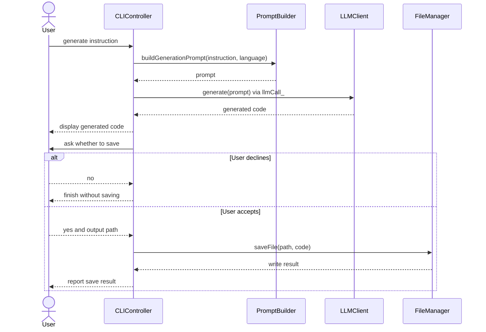
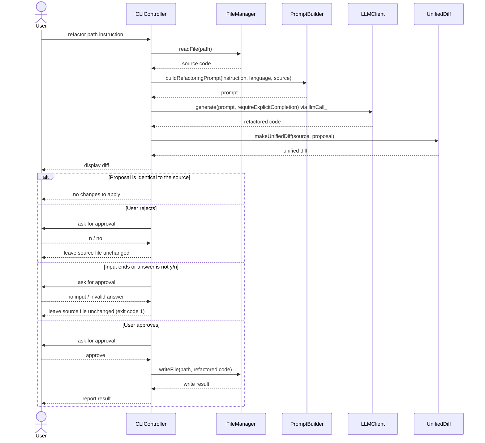
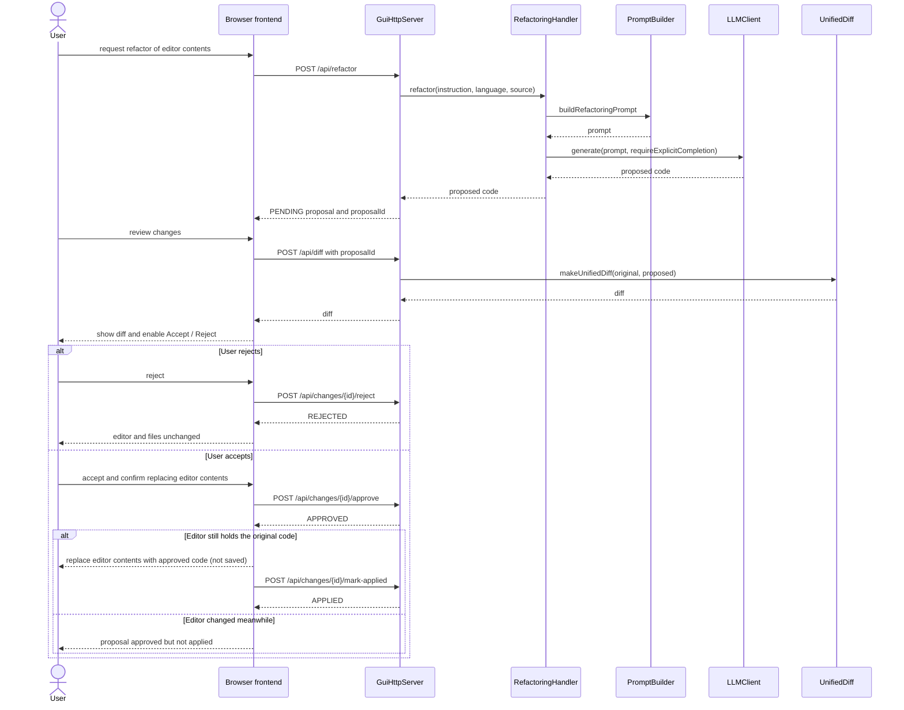
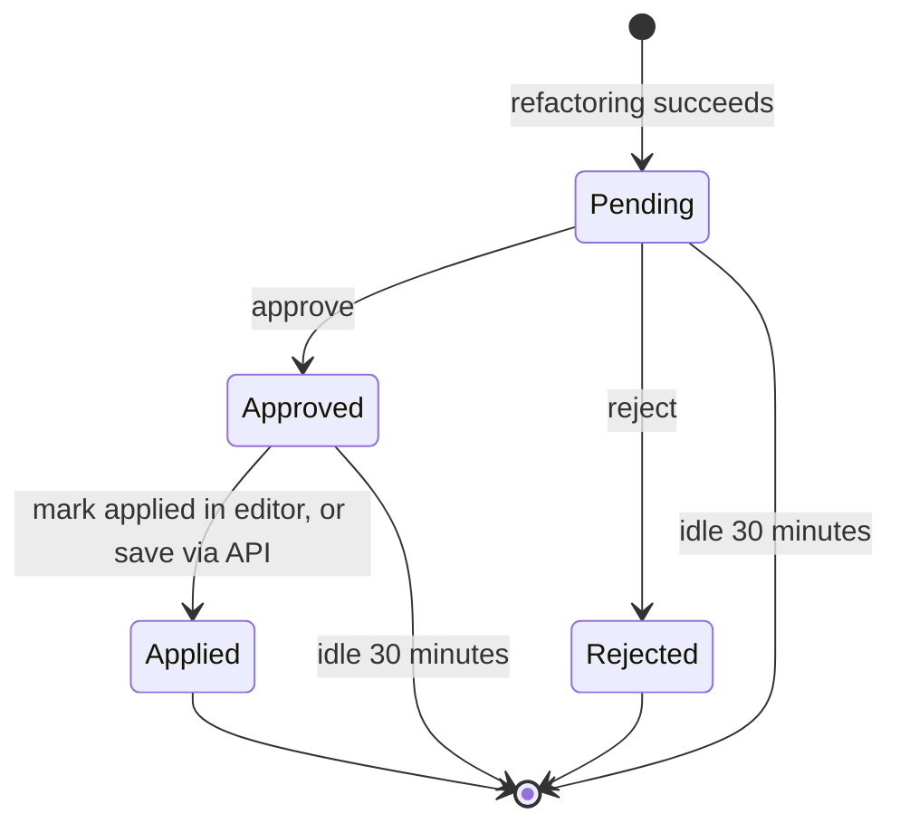

# UML diagrams

These diagrams show the main parts of CodeAgent and how its generation and
refactoring flows work. Read them from top to bottom: the class diagram shows
the code structure, sequence diagrams show messages in time order, and the
state diagram shows the life of a GUI refactoring proposal.

## How to read these diagrams

- In the class diagram, `+` means public and `-` means private. A solid
  inheritance arrow points to the parent class; a dashed implementation arrow
  points to the interface being implemented. A dashed dependency arrow means
  one part uses another. `<<utility>>` marks a group of utility functions.
- In sequence diagrams, time moves downward. Arrows show calls and returned
  results. `alt` shows either/or paths and `opt` marks an optional step.
- In the state diagram, arrows show allowed status changes. `[*]` represents
  the start or end of the proposal lifecycle.
- Names such as `PromptBuilder` and `LLMClient` refer to the C++ classes;
  `UI` refers to the browser frontend and `API` to the local HTTP server.
  `<<std>>` marks a C++ standard library class.

## Class diagram

This is a map of the main C++ types. It highlights who is responsible for
commands, files, prompts, model requests, GUI requests, and errors. It leaves
out small helpers and detailed method parameters to keep the map readable.

`GuiHttpServer` does not call `PromptBuilder` or `LLMClient` itself. It is
given generation and refactoring handlers, and those handlers (defined next to
`CLIController`, which starts the server) build the prompt and call the model.

```mermaid
classDiagram
    direction TB

    class CLIController {
        -LLMCall llmCall_
        -istream& input_
        -ostream& output_
        -ostream& error_
        -GuiCommand guiCommand_
        +run(argc, argv) int
        -dispatch(argc, argv) int
        -offerToSave(generatedCode) int
    }

    class FileManager {
        -path permissionFilePath_
        -istream& input_
        -ostream& output_
        -ostream& error_
        +readFile(filePath, content) bool
        +writeFile(filePath, content) bool
        +saveFile(filePath, content, prompt) WriteResult
        +isValidSourceFile(filePath) bool
        -writeAtomically(filePath, content) void
        -requestPermission(filePath, permission) bool
        -requestOverwritePermission(filePath) bool
    }

    class PromptBuilder {
        +buildGenerationPrompt(instruction, language, prompt) bool
        +buildRefactoringPrompt(instruction, language, sourceCode, prompt) bool
        -isValidInstruction(instruction) bool
        -isValidLanguage(language) bool
        -isValidSourceCode(sourceCode) bool
    }

    class LLMClient {
        -HttpTransport transport_
        -string model_
        +generate(prompt, options) GenerationResult
        +generateContent(prompt, response) bool
        +generateCompleteContent(prompt, response) bool
        -generateContentReportingErrors(prompt, response, requireExplicitCompletion, thoughts) bool
    }

    class ResponseParser {
        +parseResponse(responseBody) ParsedResponse
        +parseProviderError(responseBody) optional~ProviderErrorDetails~
    }

    class UnifiedDiff {
        <<utility>>
        +makeUnifiedDiff(original, proposed)$ string
    }

    class NativeDialogProvider {
        <<interface>>
        +choose(kind)* NativeDialogResult
    }

    class SystemNativeDialogProvider {
        +choose(kind) NativeDialogResult
    }

    class GuiHttpServer {
        -unique_ptr~Impl~ impl_
        +start() bool
        +stop() void
        +isRunning() bool
        +port() int
        +issueBootstrapCode() string
        +allowDevelopmentOrigin(origin) bool
        +serveFrontend(directory) bool
        +setClock(clock) bool
    }

    class runtime_error {
        <<std>>
        +what() const char*
    }

    class CodeAgentError {
        <<abstract>>
        -shared_ptr~string~ diagnostic_
        +code()* const char*
        +httpStatus()* int
        +diagnostic() string&
    }

    class ConfigurationError {
        +code() const char*
        +httpStatus() int
    }

    class FileError {
        +code() const char*
        +httpStatus() int
    }

    class ProviderError {
        +code() const char*
        +httpStatus() int
    }

    class FilePermissionError {
        +code() const char*
        +httpStatus() int
    }

    class FileNotFoundError {
        +code() const char*
        +httpStatus() int
    }

    class FileConflictError {
        +code() const char*
        +httpStatus() int
    }

    class AuthenticationError {
        +code() const char*
    }

    class RateLimitError {
        +code() const char*
        +httpStatus() int
    }

    class ProviderUnavailableError {
        +code() const char*
        +httpStatus() int
    }

    class NetworkError {
        +code() const char*
    }

    class TimeoutError {
        +code() const char*
        +httpStatus() int
    }

    class ProviderResponseError {
        +code() const char*
    }

    NativeDialogProvider <|.. SystemNativeDialogProvider : implements
    runtime_error <|-- CodeAgentError : inherits
    CodeAgentError <|-- ConfigurationError : inherits
    CodeAgentError <|-- FileError : inherits
    CodeAgentError <|-- ProviderError : inherits
    FileError <|-- FilePermissionError : inherits
    FileError <|-- FileNotFoundError : inherits
    FileError <|-- FileConflictError : inherits
    ProviderError <|-- AuthenticationError : inherits
    ProviderError <|-- RateLimitError : inherits
    ProviderError <|-- ProviderUnavailableError : inherits
    ProviderError <|-- NetworkError : inherits
    NetworkError <|-- TimeoutError : inherits
    ProviderError <|-- ProviderResponseError : inherits

    CLIController ..> FileManager : uses
    CLIController ..> PromptBuilder : uses
    CLIController ..> LLMClient : uses
    CLIController ..> UnifiedDiff : uses
    CLIController ..> GuiHttpServer : starts and supplies handlers

    GuiHttpServer ..> UnifiedDiff : computes diff
    GuiHttpServer ..> NativeDialogProvider : uses
    LLMClient ..> ResponseParser : parses responses
```

## CLI code generation

This shows the `generate` command from the user's instruction through prompt
creation and model response. `CLIController` reaches the model through its
injected `llmCall_`, which by default calls `LLMClient::generate`. Saving is
optional; declining leaves the code displayed in the terminal without writing a
file.

## CLI refactoring

This shows the `refactor` command. The original file is read first, and the
proposed changes are displayed as a diff. The model must report the response
as complete (`requireExplicitCompletion`). The file is written only after the
user approves; a proposal identical to the source ends without asking.

## GUI refactoring proposal lifecycle

The browser asks the server to create a proposal, then fetches and displays its
diff. Approve and Reject stay disabled until the diff has been reviewed. The
server reaches the model through the refactoring handler it was given, which
builds the prompt and calls `LLMClient`. Accepting a proposal replaces the
editor contents, not the file on disk; the user saves the editor separately.
Rejecting it leaves the editor and files unchanged.

The API also accepts `POST /api/save` with a `proposalId` to write an approved
proposal straight to a file, which marks it `APPLIED`. The current browser
frontend does not use this path.

## Proposal states

`PENDING` proposals can be approved or rejected. An approved proposal becomes
`APPLIED` after it is applied in the editor, or saved through the API.
Rejected and applied proposals are finished states. A pending or approved
proposal left idle for 30 minutes can be discarded by the server to make room
for new ones.

