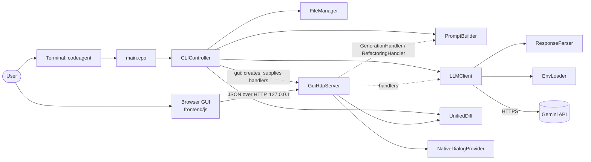
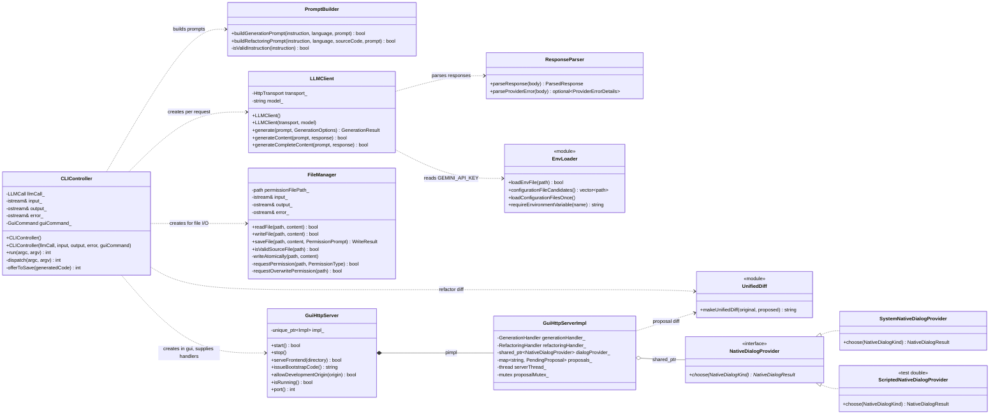
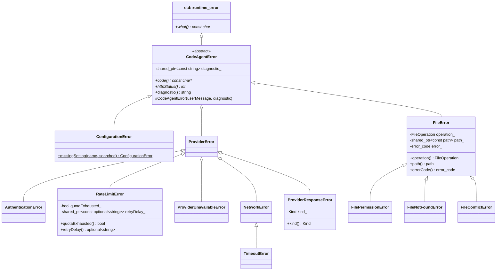
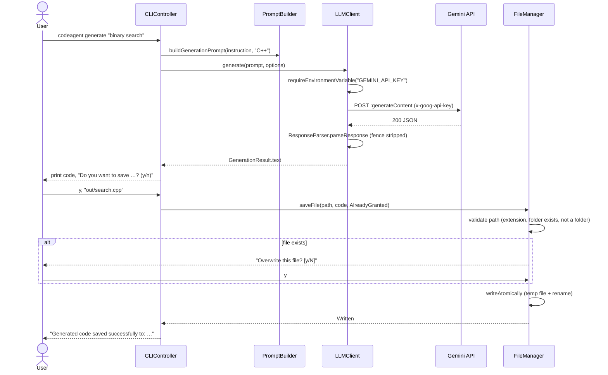

# CodeAgent — Project Report

This report describes the CodeAgent implementation as it exists in this repository on branch `integration/gui-complete`. Every class, mechanism, and test named here exists in the source; anything not implemented or not verified is marked as such in [Limitations and unverified behaviour](#15-limitations-and-unverified-behaviour).

## 1. Problem statement

Developers increasingly use large language models (LLMs) to write and restructure code, but typical chat interfaces are disconnected from the files being edited: code is copied by hand, there is no reviewable diff, and nothing prevents an unreviewed answer from overwriting work. Errors from the model provider (an invalid key, a rate limit, a timeout) often surface as generic failures.

CodeAgent connects Gemini to local C++ files with the user in control: generated code and proposed refactorings are shown first, changes are written only after explicit approval and through atomic writes, and every failure is reported with its actual cause and a next step.

## 2. Objectives

1. Generate C++ code from a natural-language instruction, from the terminal and from a browser GUI.
2. Refactor an existing file: send it with an instruction, show the result as a unified diff, and apply it only after approval.
3. Save results safely: validated paths, overwrite confirmation, atomic replacement, no silent data loss.
4. Handle configuration, network, provider, parsing, and file-system failures with typed C++ exceptions and actionable messages.
5. Keep secrets secret: the API key never appears in output, logs, exceptions, or the browser.
6. Make the `codeagent` command usable from any directory after installation.
7. Keep the core testable without network access.

## 3. Scope

**In scope (implemented):** `generate`, `refactor`, `gui`, and `help` commands; interactive save after `generate`; a local GUI server with chat, editor, proposal review, Save/Save As, and Resend Prompt; Gemini integration with structured error classification; installation to a user prefix; unit, integration, and smoke tests.

**Out of scope:** multi-file or whole-project refactoring; languages other than C and C++ for files; executing or compiling generated code; other LLM providers; native Windows and macOS builds; remote (non-loopback) access to the GUI.

## 4. Architecture



| Component | Files | Responsibility |
| --- | --- | --- |
| `main` | `src/main.cpp` | Creates the controller; last-resort exception boundary. |
| `CLIController` | `include/CLIController.hpp`, `src/CLIController.cpp` | Parses commands, runs the terminal workflows (generate + save, refactor + approval), starts the GUI server and wires its handlers, and is the terminal's exception boundary. |
| `PromptBuilder` | `include/PromptBuilder.hpp` | Builds deterministic generation and refactoring prompts; validates their inputs. |
| `LLMClient` | `include/LLMClient.hpp` | Sends requests through an injectable HTTP transport (libcurl by default), classifies failures into exceptions, and validates responses. |
| `ResponseParser` | `include/ResponseParser.hpp` | Turns Gemini JSON into `ParsedResponse` (text, thoughts, completion status) and extracts structured error details. |
| `EnvLoader` | `include/EnvLoader.hpp` | Loads `.env` files in a defined order; provides required settings or throws `ConfigurationError`. |
| `FileManager` | `include/FileManager.hpp` | Terminal file I/O: reads source files, validates output paths, asks for permission and overwrite confirmation, writes atomically. |
| `UnifiedDiff` | `include/UnifiedDiff.hpp` | Produces a unified diff of two texts (used by the CLI and the GUI). |
| `GuiHttpServer` | `include/GuiHttpServer.hpp` | Loopback HTTP server: serves the frontend, authenticates the session, validates requests, manages proposals, reads and writes files for the editor. |
| `NativeDialogProvider` | `include/NativeDialog.hpp` | Interface for native file/folder pickers (zenity or PowerShell under WSL). |
| `CodeAgentError` hierarchy | `include/CodeAgentError.hpp` | Typed failures with safe messages, redacted diagnostics, error codes, and HTTP statuses. |
| Frontend | `frontend/js/*.js` | `api.js` (validated API client), `app.js` (UI state and workflows), `chatTranscript.js`, `proposalWorkflow.js`, `diffView.js`. |

The dependency direction is deliberate: `GuiHttpServer` knows nothing about Gemini. It receives two `std::function` handlers from `CLIController`, so the server can be tested with fake handlers and the provider could be replaced without touching it (dependency inversion).

## 5. UML class diagrams

### 5.1 Core classes



`GuiHttpServerImpl` is the private `GuiHttpServer::Impl` class defined in `src/GuiHttpServer.cpp`. `SystemNativeDialogProvider` is defined in `src/NativeDialog.cpp` (one implementation per platform, chosen at compile time) and created by `createNativeDialogProvider()`. `ScriptedNativeDialogProvider` exists only in `tests/GuiHttpServerTest.cpp`.

### 5.2 Exception hierarchy



| Class | `code()` | `httpStatus()` |
| --- | --- | --- |
| `ConfigurationError` | `CONFIGURATION_ERROR` | 503 |
| `ProviderError` | `PROVIDER_ERROR` | 502 |
| `AuthenticationError` | `PROVIDER_AUTH_FAILED` | 502 |
| `RateLimitError` | `PROVIDER_RATE_LIMITED` or `PROVIDER_QUOTA_EXHAUSTED` | 429 |
| `ProviderUnavailableError` | `PROVIDER_UNAVAILABLE` | 503 |
| `NetworkError` | `PROVIDER_UNREACHABLE` | 502 |
| `TimeoutError` | `PROVIDER_TIMEOUT` | 504 |
| `ProviderResponseError` | `PROVIDER_RESPONSE_INVALID`, `_BLOCKED`, or `_INCOMPLETE` | 502 |
| `FileError` | `READ_FAILED` or `SAVE_FAILED` | 500 |
| `FilePermissionError` | `PERMISSION_DENIED` | 403 |
| `FileNotFoundError` | `FILE_NOT_FOUND` | 404 |
| `FileConflictError` | `FILE_CHANGED_ON_DISK` | 409 |

## 6. Sequence diagrams

### 6.1 Terminal: generate and save



If `saveFile` returns `InvalidPath`, the CLI asks for another path; `Declined` offers a different path; `Failed` ends with exit status 1 and the specific cause (permission, missing folder, or the operating-system error).

### 6.2 GUI: refactoring proposal

```mermaid
sequenceDiagram
    actor User
    participant UI as Browser (app.js)
    participant S as GuiHttpServer
    participant H as RefactoringHandler (from CLIController)
    participant LLM as LLMClient
    User->>UI: instruction + editor code, "Create proposal"
    UI->>S: POST /api/refactor (token, sourceCode, instruction)
    S->>S: validate; reserve proposal capacity (RAII)
    S->>H: handler(instruction, language, sourceCode)
    H->>LLM: generate(prompt, requireExplicitCompletion)
    LLM-->>H: proposed code
    H-->>S: true, proposedCode, thoughts
    S-->>UI: 200 {proposalId, status: PENDING, …}
    User->>UI: Review changes
    UI->>S: POST /api/diff {proposalId}
    S-->>UI: {diff} (makeUnifiedDiff)
    User->>UI: Accept
    UI->>S: POST /api/changes/{id}/approve
    S-->>UI: {status: APPROVED}
    UI->>UI: editor = proposed code (unsaved)
    UI->>S: POST /api/changes/{id}/mark-applied
    User->>UI: Save (Ctrl+S)
    UI->>S: POST /api/files/write {path, content, baseRevision}
    S-->>UI: {status: SAVED, revision}
```

### 6.3 Error propagation: rate limit in the GUI

```mermaid
sequenceDiagram
    participant UI as Browser
    participant S as GuiHttpServer route
    participant H as GenerationHandler
    participant LLM as LLMClient
    participant G as Gemini API
    UI->>S: POST /api/generate
    S->>H: handler(...) inside try
    H->>LLM: generate(...)
    LLM->>G: request
    G-->>LLM: 429 RESOURCE_EXHAUSTED + RetryInfo 30s
    LLM->>LLM: parseProviderError → throw RateLimitError
    LLM--xH: RateLimitError (propagates, no catch)
    H--xS: RateLimitError
    S->>S: catch (const CodeAgentError&) → respondWithError
    S-->>UI: 429 {code: PROVIDER_RATE_LIMITED, message: "Request rate limited. …"}
    UI-->>UI: show error reply in chat; Resend prompt stays enabled
```

## 7. Exception handling design

**Throw sites.** Failures are thrown where they are detected, as the most specific type:

| Where | What is thrown |
| --- | --- |
| `EnvLoader::requireEnvironmentVariable` | `ConfigurationError` (missing `GEMINI_API_KEY`; the diagnostic lists the `.env` files checked) |
| `CLIController` (`resolveGuiPort`, development origin) | `ConfigurationError` for invalid `CODEAGENT_GUI_PORT` / `CODEAGENT_DEV_ORIGIN` |
| libcurl transport in `LLMClient.cpp` | `TimeoutError` (`CURLE_OPERATION_TIMEDOUT`), `NetworkError`, `ProviderResponseError` (response over 2 MiB) |
| `throwHttpError` in `LLMClient.cpp` | `AuthenticationError`, `RateLimitError`, `TimeoutError`, `ProviderUnavailableError`, `ProviderError`, chosen from Gemini's structured `status`, `ErrorInfo.reason`, `QuotaFailure`, and `RetryInfo` |
| `LLMClient::generate` | `ProviderResponseError` (malformed, blocked, or incomplete response); `std::invalid_argument` for an empty prompt (a programming error, not a user-facing failure) |
| `throwFileSystemError` | `FilePermissionError`, `FileNotFoundError`, or `FileError`, from the operating system's `std::error_code` |
| GUI `/api/files/write` | `FileConflictError` when the file changed since it was opened |

**Catch boundaries.** Exceptions are caught only where a failure can be reported to the user:

| Boundary | Behaviour |
| --- | --- |
| `CLIController::run` | Catches `CodeAgentError` (prints message and `Details:`), `std::bad_alloc`, then `std::exception`; returns exit status 1. `dispatch` contains the command logic and is free to throw. |
| `main` | Catches anything thrown before `run` (for example during construction), so the program never ends in `std::terminate`. |
| GUI routes (`/api/generate`, `/api/refactor`, file routes) | `catch (const CodeAgentError&)` → `respondWithError`, which uses the virtual `httpStatus()` and `code()`; `catch (...)` → logged with `logUnexpectedException`, generic message without the exception text. |
| `set_exception_handler` | Uses `std::rethrow_exception` on the `std::exception_ptr` to tell the type apart; the server keeps running. |
| `FileManager::saveFile` | Catches `FilePermissionError`, `FileNotFoundError`, `FileError` from `writeAtomically` and maps them to terminal wording and a `WriteResult`. |
| `LLMClient::generateContent` (bool API) | Kept for callers that only need success/failure; catches `CodeAgentError` and `std::invalid_argument`, logs, and returns `false`. |

Catch order goes from the most derived to the least derived type. No catch block is empty: the one that cannot log through the stream (inside `logUnexpectedException`) falls back to `std::fputs`, which does not throw.

**Safety of the exception objects.** `what()` holds only a safe message. Technical detail is in `diagnostic()`, redacted by `redactSecrets` when the exception is constructed. Members that could throw on copy (`std::string`, `std::filesystem::path`, `std::optional<std::string>`) are held as `std::shared_ptr<const T>`, so copying an exception — which happens while it propagates — cannot throw. `tests/CodeAgentErrorTest.cpp` enforces this with `static_assert(std::is_nothrow_copy_constructible_v<…>)`; the assertion found a real problem (`FileError` held a `path` by value) during development.

**Recovery.** Every failure leaves the system consistent: atomic writes keep the original file on failure; a failed refactor releases its proposal reservation (RAII) and creates no proposal; the GUI keeps the prompt and enables Resend Prompt; the CLI never reports a save that did not happen.

## 8. Object-oriented design

| Concept | Where and why |
| --- | --- |
| Encapsulation | Every class keeps its state private (`LLMClient::transport_`, `FileManager::permissionFilePath_`, `CLIController::llmCall_`). `GuiHttpServer` hides all of its state — threads, mutexes, proposals, secrets — behind a pointer to a private implementation (pimpl), so its header exposes only the public operations and does not include cpp-httplib. |
| Access modifiers | Public interfaces are small; helpers are private (`FileManager::writeAtomically`, `CLIController::dispatch`). `CodeAgentError`'s constructor is `protected`, so only subclasses can create errors; subclasses with no further specialization are `final`. |
| Inheritance | `CodeAgentError` → `ProviderError` → `NetworkError` → `TimeoutError` models "is-a" relations that callers use: catching `NetworkError` also handles timeouts; catching `FileError` handles permission, not-found, and conflict errors. |
| Runtime polymorphism | `CodeAgentError::code()` and `httpStatus()` are pure virtual; one `respondWithError(const CodeAgentError&)` reports all twelve types. `NativeDialogProvider::choose` is pure virtual; the server calls it through a `shared_ptr<NativeDialogProvider>` and tests substitute a scripted provider. |
| Abstraction | `NativeDialogProvider` is an interface (pure virtual function, virtual destructor). `CodeAgentError` is an abstract base. |
| Composition and aggregation | `GuiHttpServer` owns its `Impl` (`std::unique_ptr`, composition); `Impl` shares the dialog provider (`std::shared_ptr`, aggregation). |
| Dependency injection | `LLMClient` takes an `HttpTransport`; `CLIController` takes an `LLMCall`, streams, and a `GuiCommand`; `GuiHttpServer` takes handlers, a dialog provider, and a clock. This is what makes the 206 tests run without network access. |
| Separation of concerns | Configuration (`EnvLoader`), prompting (`PromptBuilder`), transport and classification (`LLMClient`), parsing (`ResponseParser`), terminal files (`FileManager`), HTTP (`GuiHttpServer`), diffs (`UnifiedDiff`). |
| Object lifetime | `GuiHttpServer` is non-copyable; its destructor stops the listener and joins the worker thread. RAII guard types (`ProposalCapacityReservation`, `FileDescriptor`, `TemporaryFileGuard`) delete copying. `FileManager` and `CLIController` hold stream references, so they must not outlive the streams they are given; every caller creates them on the stack in the same scope as the streams. |

Where inheritance was *not* used, deliberately: the GUI handlers and the HTTP transport are `std::function` values rather than abstract classes, because each is a single operation and lambdas are the lighter way to supply one. No class was added only to show a concept.

## 9. Advanced C++ mechanisms

| Mechanism | Use in the code |
| --- | --- |
| Exceptions | Custom hierarchy, `throw`/`try`/`catch` with ordered handlers, rethrow (`throw;` in the proposal rollback), `std::exception_ptr` and `std::rethrow_exception` in the server's exception handler and in `logUnexpectedException`, `[[noreturn]]` throw helpers. |
| RAII | `std::unique_ptr<CURL, CurlEasyDeleter>` and `std::unique_ptr<curl_slist, CurlHeaderListDeleter>` release libcurl resources on every path; `FileDescriptor` closes a POSIX descriptor; `TemporaryFileGuard` removes a temporary file unless it was renamed into place; `ProposalCapacityReservation` releases a proposal slot; `std::lock_guard`/`std::unique_lock` for every mutex. |
| Smart pointers | `std::unique_ptr` for exclusive ownership (pimpl, curl handles); `std::shared_ptr` for the shared dialog provider and for immutable exception members. No owning raw `new`/`delete` in the code. |
| Templates | The design relies on standard class templates instantiated with project types: `std::unique_ptr` with custom deleter types, `std::function` for injected behaviour, `std::optional`, `std::map`, `std::shared_ptr<const T>`. No custom template was written: no generic behaviour in the code is needed for more than one type, so a template would add complexity without reuse. |
| Operator overloading | The deleters overload the function-call operator (`operator()`), which is what makes them usable as `std::unique_ptr` deleters. RAII types delete the copy assignment operator (`operator= = delete`) to prevent double release. No arithmetic or comparison operators are overloaded, because no class in the project is a value type for which they would have an obvious meaning. |
| Move semantics | Strings, paths, handlers, and results are moved into place (`std::move`), for example the `GenerationResult` text and the handlers passed to `GuiHttpServer`. |
| Lambdas | Handlers wired in `CLIController`, transports in tests, the `std::call_once` initializer for libcurl. |
| Concurrency | The GUI server runs on a worker thread; shared state is protected by separate mutexes (configuration, proposals, saves, documents, sessions); `std::atomic` for the bound port and temp-file sequence; `std::call_once` and function-local statics for one-time initialization. |
| Compile-time checks | `constexpr` limits, `static_assert` on exception copy guarantees, `noexcept` on accessors and deleters, `enum class` for every state type. |
| `std::filesystem` and `std::error_code` | Path validation and atomic replacement; non-throwing overloads are used where a failure is expected and converted to a typed exception at the module boundary. |

## 10. Testing

| Suite | Tests | What it covers |
| --- | --- | --- |
| `ResponseParserTest` | 32 | Text and thought parts, fences, finish reasons, malformed and blocked responses |
| `LLMClientTest` | 26 | Requests, API key handling, every HTTP/provider failure class, timeouts, malformed responses, key redaction (mocked transport) |
| `CLIControllerTest` | 23 | Commands, refactor approval, interactive save after `generate` (decline, valid path, invalid paths, overwrite, write failure, EOF), error boundary |
| `GuiHttpServer*Test` (10 suites) | 81 | Health, origins, host checks, sessions, generation, refactoring, proposals, saves, documents, dialogs, typed errors over HTTP |
| `PromptBuilderTest` | 9 | Prompt construction and validation |
| `EnvLoaderTest` | 8 | `.env` parsing, lookup order, precedence, missing explicit file, diagnostics |
| `FileManagerTestFixture` / `SaveFileTest` | 7 + 5 | Reading, writing, path validation, overwrite confirmation, permission and write failures |
| `CodeAgentErrorTest` | 7 | Hierarchy, virtual dispatch, file-error mapping, redaction, no-throw copying |
| `UnifiedDiffTest` | 7 | Diff hunks, line endings |
| `NativeDialogPathTest` | 1 | Windows-to-WSL path translation |
| **C++ total** | **206** | `ctest --test-dir build` |
| Frontend (`node --test`) | 78 | API client validation, proposal workflow, diff rendering, the real `app.js` against a test DOM (chat, Resend Prompt, Save/Save As, theme rules) |
| `scripts/smoke-test.sh` | 12 checks | Installed command from a clean shell outside the repository; real Gemini request with an invalid key; GUI serving its installed frontend and API |

Test doubles replace every external dependency: the HTTP transport (canned Gemini responses, including structured errors), the GUI handlers, the clock (expiry tests), the native dialogs, and the terminal streams.

## 11. Configuration and installation

**Lookup order.** Variables already in the environment, then `CODEAGENT_ENV_FILE`, then `./.env`, then `$XDG_CONFIG_HOME/codeagent/.env` (`~/.config/codeagent/.env`). Loading never overwrites a variable, so the first source wins. The user-level file makes the key available in every directory; the project file allows per-project overrides; the explicit file serves scripts. The lookup is implemented by `configurationFileCandidates()` and `loadConfigurationFiles()` in `EnvLoader` and runs once per process (`loadConfigurationFilesOnce`, a thread-safe function-local static) before the GUI server starts its threads, because `setenv` is not thread-safe.

**Resources.** The binary finds the frontend relative to its own path (`/proc/self/exe`): `CODEAGENT_FRONTEND_DIR`, then `frontend/` beside or above the binary (build tree), then `../share/codeagent/frontend` (installed layout), then the source tree recorded at build time.

**Installation.** `scripts/install.sh` builds a Release configuration, runs the tests, and runs `cmake --install` into `~/.local`, producing `bin/codeagent` and `share/codeagent/frontend/`. GoogleTest's own install rules are disabled (`INSTALL_GTEST OFF`); before that change, an install also copied GoogleTest headers and libraries into the prefix.

## 12. File I/O

* **Terminal (`FileManager`).** Reads only existing regular files with a supported extension, after asking for read permission (once, or always via `.codeagent/permissions.txt`). Writes validate the path first (`InvalidPath`), ask for write permission unless the user just typed the path, always confirm overwriting, and write through `<file>.codeagent.tmp` plus a rename. Failures carry the operating-system cause.
* **GUI (`GuiHttpServer`).** Opens files only on an explicit request, refuses FIFOs and devices without blocking (`O_NONBLOCK`, `fstat`), enforces 512 KiB while reading, and saves in place only to files opened in the session, detecting external changes through a content hash (`baseRevision`). Save As writes only plain file names into the active output directory. Writes are atomic and keep permission bits.

## 13. Frontend and backend integration

The browser and the C++ server communicate through the JSON API documented in [gui-api-contract.md](gui-api-contract.md). Every error response has the shape `{"error": {"code", "message"}}`; the frontend shows the message and uses the code for decisions (for example, `FILE_CHANGED_ON_DISK` leads to an overwrite confirmation). `api.js` validates every response shape before the UI uses it. The UI renders model output only through `textContent`, never as HTML.

| Feature | Backend | Frontend | Verified by |
| --- | --- | --- | --- |
| Generation and refactoring | `/api/generate`, `/api/refactor` | `app.js` `sendPrompt` | `GuiHttpServerGenerationTest`, `GuiHttpServerRefactoringTest`, DOM tests |
| Chat history, thoughts, errors | — | `chatTranscript.js` | DOM tests |
| Resend Prompt | same routes | `resendLastPrompt` | 6 DOM tests |
| Diff and proposal decisions | `/api/diff`, `/api/changes/{id}/…` | `proposalWorkflow.js`, `diffView.js` | `GuiHttpServerProposalReviewTest`, frontend tests |
| Editor files | `/api/files/read`, `/api/files/write`, `/api/save` | Save, Save As, Reload | `GuiHttpServerDocumentTest`, `GuiHttpServerSaveTest`, DOM tests |
| Theme | static files | `css/*.css` | DOM tests check layout rules; screenshots during development |

## 14. Key design decisions

| Decision | Reason |
| --- | --- |
| Exceptions for failures, `bool`/enum results for expected outcomes | A missing key or a network error must cross several layers to a boundary that can report it; exceptions carry the cause without threading error codes through every call. A declined overwrite or an invalid path typed by the user is an expected outcome, so `saveFile` returns `WriteResult` instead. |
| Classify Gemini errors from structured details | Gemini reports an invalid key as HTTP 400, and 429 means either a short rate limit or an exhausted daily quota. Only `ErrorInfo.reason` and `QuotaFailure` tell them apart. |
| Never show provider free text | Provider messages can echo request data; only validated enum-like fields are logged. |
| Loopback server with a per-session token | Other websites and other local users cannot drive the API, even though it runs on `localhost`. |
| Proposals instead of direct writes | The user reviews a diff and decides; the editor, not the server, applies the change, and saving is a separate explicit step. |
| Atomic writes everywhere | A crash or failure during a write never leaves a truncated file. |
| User-level configuration file | Makes `codeagent` work from any directory without copying the key into each project or exporting it in every shell. |
| Install to `~/.local` by default | No root access needed; Ubuntu already puts `~/.local/bin` on `PATH`. |

## 15. Limitations and unverified behaviour

* Supported only on Linux/WSL2; native Windows and macOS builds have never been built.
* The WSL PowerShell file dialog and the browser launch have not been exercised by automated tests with a real user; their launch paths and path translation are tested.
* The GUI has no automated real-browser test; the frontend logic is tested against a test DOM, and the visual design was checked with headless screenshots during development.
* The editor is a plain text area without syntax highlighting.
* One file at a time, C and C++ only, up to 512 KiB.
* Generated code is not compiled or executed; its correctness is the user's responsibility.
* Successful generation depends on Gemini's availability, quota, and rate limits. The automated tests mock Gemini; the smoke test only confirms that a real request reaches Gemini and that its rejection of an invalid key is reported correctly.

## 16. Contributions

Commits on `integration/gui-complete` as recorded by Git (`git log --format=%an`). Stash entries and tool checkpoint refs on other refs are not counted. Commit authorship shows who committed a change; it does not capture pair work, design discussion, testing, or report writing done outside commits.

| Member | Commits | Areas, from commit history |
| --- | --- | --- |
| Lalitadithya Kariyam | 25 | Initial repository and planning; CLI foundation and command controller; Prompt Builder; first Gemini integration for CLI generation and refactoring; GUI API contract and dependency decisions; local GUI HTTP server with health, configuration, generation, and save endpoints; `codeagent gui` command; frontend API client, backend status, generation wiring, styling; secure frontend integration; chat interface with Gemini thoughts; Save As and copy improvements; panel alignment. |
| SamuelJohn | 28 | FileManager and its GoogleTest suite; Gemini response parser; safe file replacement and read fixes; frontend HTML structure, design foundation, header, mode cards, workspace, editor, and proposal review UI; CLI refactoring diff and approval; GUI refactoring endpoint, proposal diff and approval workflow; native file and folder dialogs; frontend file selection; serving the frontend from `codeagent gui`; Resend Prompt; exception hierarchy; interactive save for `generate`. |

_Team to complete:_ describe contributions not visible in commits, and declare any tools used (for example AI coding assistants) as your institution requires.

## 17. Future work

* Project-level refactoring across several files with context selection.
* Configurable model and provider behind the existing `HttpTransport` and handler seams.
* Streaming responses and cancellation.
* Syntax highlighting in the editor.
* Continuous integration and packaged releases.
